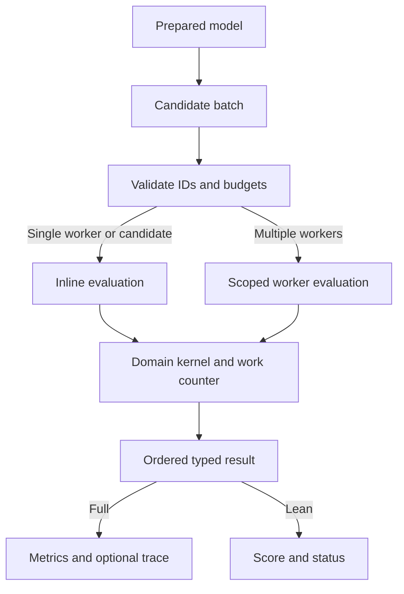

# Population epidemiology architecture

Version 0.2.0. Evaluate a small, fixed-population SIR model, neutral two-mutant Moran drift, and an exact two-state rate calendar.

## Evaluation pipeline

| Boundary | Location | Responsibility |
| --- | --- | --- |
| Request and CLI | `src/main.rs`, `src/lib.rs`, `models/request.json` | Versioned request schema, exact model-byte hash, typed validation, JSON output and exit code |
| Python boundary | `python/population_epidemiology/__init__.py`, PyO3 in `src/lib.rs` | Encode once per batch, release the Python GIL during native evaluation, decode the typed result envelope |
| Prepared engine | `src/lib.rs` | Own immutable domain data, enforce batch rules, dispatch candidates and retain ordered result rows |
| Domain | `src/domain.rs` | Bind the candidate, execute model logic, classify status and compute a minimization objective |
| Campaign | `python/population_epidemiology/campaign.py` | Local SQLite replay, attempt journal and complete-result caching |
| Verification | `validation/`, `examples/`, `evidence/` | Independent checks, executable examples and paired performance observations |

## Data and execution contracts

`Prepared::new` hashes the model bytes, deserializes the model and
validates its bounds before building domain caches. The Python
wrapper encodes models with sorted keys and finite JSON numbers.
Two inputs that differ in their serialized representation can
have different provenance hashes. Result and request schema tags
remain at 0.1. Package version is reported separately.

Every batch validates candidate count (1–4096), unique IDs, parameter
vector length (up to 64), requested workers (1–64) and trace count
(up to 16). Parallel workers claim indexes through an atomic cursor.
Each assigned index owns a result slot written once. After workers
join, output is serialized in input order. Single-worker or singleton
calls run inline. The typed prepared envelope borrows candidate IDs
until serialization completes. The CLI retains its full `Value` API.

`Work` counts domain-defined steps per candidate. Its fast branch
handles unmonitored steps below the limit. Monitored steps check
the cancel file, then batch deadline, then work budget. Domain
checks can still reject an invalid candidate before it takes a step.
Cancellation and deadlines are cooperative. The wall clock can
change which candidates finish, while fixed-work replays should agree
independent of worker count. Candidate parallelism creates scoped
threads per batch. Concurrent callers should account for total
worker demand when choosing batch settings.

Full records contain domain metrics and any requested trace.
`scores_json` in Rust and `Prepared.scores` in Python return the
same record keys with null metrics and reject traced candidates.
Both retain per-candidate limits, diagnostics needed for feasibility,
numeric score checks and failure status. Full replay restores
inspection details for the selected candidate.

## Domain internals

| Model | Prepared state | Evaluation and checks |
| --- | --- | --- |
| SIR | Observations, train boundary, time grid, initial counts and tolerance | Bind two rates, construct the CRN count model and FSP run, run the bundled solver with one inner thread, project infected first moments, score observed training points |
| Moran | Triangular states, initial offset, flat transitions and row offsets | Allocate two probability vectors, apply the neutral recurrence in row order, derive complete marginals and optionally emit the joint law |
| Calendar | Exact times and on-probabilities at each boundary | Charge one logical step per segment, return last probability, serialize cached boundaries in full mode |

Moran topology has `(N+1)(N+2)/2` states. Parent/death outcome order is
preserved, including repeated destinations from self replacement. CSR
offsets avoid a heap allocation per row and improve locality without
changing probability accumulation order. Fixed-work results still
charge the logical topology visits and propagation visits. The calendar
uses `expm1` for the segment change and caches the exact constant-rate
recurrence. Its unmonitored path charges all segment visits in one
operation. Deadline and cancel-file runs check each logical step.

The SIR API retains the CRN model and run hashes and optional FSP trace
when emitting full records. The companion and FSP solver count work at different boundaries. The CRN solver
receives the remaining deadline and cancel file and returns its own work
and mass diagnostics. Outer workers parallelize candidates. There is
still an FSP topology build per rate binding and SIR remains the dominant
cost for this fixture. See the [model card](model.md) for each objective.

## Persistence and boundaries of evidence

The local campaign hashes the installed extension bytes plus each
scenario, model, candidate and work settings to locate reusable
records. SQLite stores completed, invalid and infeasible results,
and keeps an append-only journal of attempts. Cancelled or time-
limited attempts remain in the journal and can be retried. SQLite
commits each chunk atomically. A new extension build changes the
cache namespace. The current workflow is local and exposes no
distributed worker protocol.

The package contains source, a source distribution, and a validated
Linux x86-64 wheel. The included performance log distinguishes the
native prepared boundary, complete Python search and clean build.
See the [tutorial](tutorial.md) for exact commands and
[the model card](model.md) for equations and research scope.
