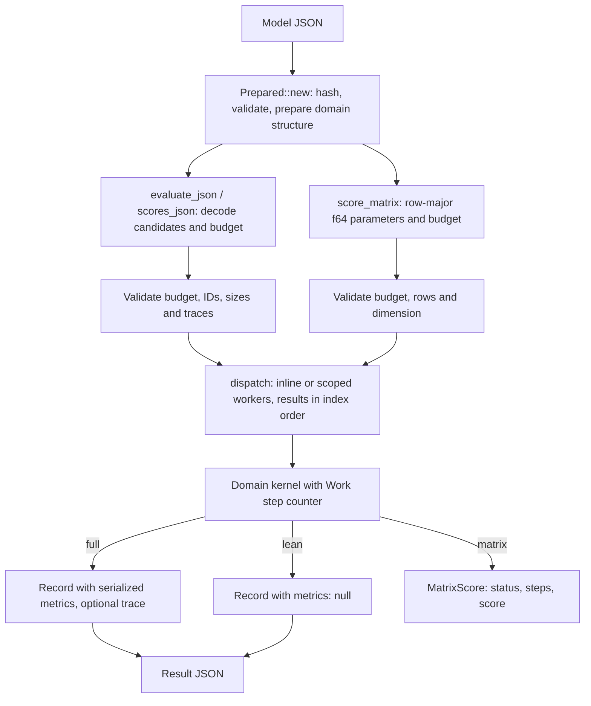

# Population epidemiology architecture

Version 0.3.0. The package evaluates three small stochastic population
models behind one prepared batch engine: a fixed-population SIR model
solved by finite state projection (FSP), neutral two-mutant Moran drift,
and an exact two-state rate calendar. This document describes the code as
of 0.3.0 and its measured performance. The [user manual](user-manual.md)
covers usage and the [model card](model.md) the equations.

## Evaluation pipeline

| Boundary | Location | Responsibility |
| --- | --- | --- |
| Request and CLI | `src/main.rs`, `run` in `src/lib.rs`, `models/request.json` | versioned request schema, exact model-byte hash, typed validation, JSON output and exit code |
| Python boundary | `python/population_epidemiology/__init__.py`, PyO3 module in `src/lib.rs` | encode once per batch, release the GIL during native evaluation, decode the result envelope; `score_matrix` passes rows without JSON |
| Prepared engine | `src/lib.rs` | own immutable domain data, enforce batch rules, dispatch candidates or rows, keep ordered results |
| Domain | `src/domain.rs` | bind a candidate, run the model kernel, classify status, compute the minimization objective and serialized metrics |
| SIR projection | `src/sir_fsp.rs` | rate-independent SIR state space and generator layout, prepared uniformization that reproduces the CRN-craft solver |
| CRN-craft solver | `crn-craft` 0.4.0 from crates.io | FSP reference and fallback path |
| Campaign | `python/population_epidemiology/campaign.py` | local SQLite replay, attempt journal and complete-result caching |
| Verification | `validation/`, `examples/`, `evidence/` | independent checks, executable examples, paired performance observations and the time breakdown |

## Data and execution contracts

`Prepared::new` hashes the model bytes with SHA-256, deserializes the
model with unknown fields rejected and validates its bounds before
building domain structure. The Python wrapper encodes models with sorted
keys, compact separators and finite numbers, so equal dictionaries give
equal hashes. Request and result schema tags remain at 0.1, and the
package version is reported separately.

Every JSON batch validates the budget (workers 1–64, `max_steps`
1–100,000,000, `wall_ms` 1–86,400,000 when present), the candidate count
(1–4,096), unique non-empty IDs of at most 128 bytes, parameter vectors of
at most 64 values and at most 16 traced candidates. `score_matrix`
applies the same budget checks to its row count and requires a
dimension of at most 64. It has no IDs and no duplicate check.

`dispatch` evaluates a single candidate, or any batch with one worker, on
the calling thread. Otherwise it starts `min(workers, count)` scoped
threads that claim indexes from an atomic cursor. Each index owns one
result slot written once, and results are collected in index order, so
records never depend on scheduling. JSON batches and matrix calls share
this code, the budget checks and the per-candidate `outcome` function,
which is how the matrix API stays equal to `scores_json` bit for bit.

`Work` counts domain-defined logical steps per candidate. Unmonitored
work (no deadline and no cancel file) can only stop at `max_steps`, so its
fast path is an increment and compare, and `Work::advance` charges many
steps at once with the same status and count as charging them one by one.
Monitored steps check the cancel file, then the batch deadline, then the
budget. Cancellation and deadlines are cooperative. Fixed-work results do
not depend on the worker count.

Three result paths share the evaluation:

- **Full** (`evaluate_json`, Python `batch` and `evaluate`): records with
  metrics. Since 0.3.0 a domain returns its metrics as serialized JSON
  (`Box<RawValue>`), which the record embeds verbatim. The CLI's
  `serde_json::Value` result parses that text back, so CLI output is
  unchanged.
- **Lean** (`scores_json`, Python `scores`): the same record keys with
  `metrics: null`. Traced candidates are rejected. Metrics closures are
  never run.
- **Matrix** (`score_matrix`, Python `score_matrix`): typed
  `MatrixScore { status, steps, score }` rows from a row-major `&[f64]`.
  It skips candidate decoding, ID checks and record encoding. The Python
  method takes a list of rows (or a 2-D NumPy array through the wrapper),
  rejects ragged rows, releases the GIL and returns scores (NaN unless
  complete), statuses and steps.

## Domain internals

### SIR

Preparation validates the model and then builds the CRN-craft model and
FSP run documents for a probe binding. If `crn_craft::check_bytes`
accepts them, every positive normal rate binding is accepted too, because
CRN-craft's validation of these documents depends on the rate values only
through their finiteness and sign and the zero-coefficient warning. `Projection::new` in
`src/sir_fsp.rs` then discovers the reachable states breadth first in
CRN-craft's order (infection before recovery), builds the generator by
column and checks the solver's output-reservation, workspace and
output-size limits once. A model that CRN-craft rejects, for example a
save grid that does not start at 0, keeps no projection, so every
candidate takes the CRN-craft path and reports its diagnostics.

Every transition lowers 2S + I by one, so breadth-first discovery
numbers states level by level, and within a level by ascending S. Each
generator column (S, I) therefore adds, in ascending source order, the
recovery source (S, I+1), the infection source (S+1, I-1) and its
diagonal. Preparation verifies this order for every column and that each
S row of states is a contiguous I range. The series vectors then live on
a zero-padded (S, I) grid, and each product row runs over three
contiguous streams. If the check failed, a fixed three-slot column kernel
with explicit source indexes would be used. A padded slot adds +0.0 to a
non-negative sum, and the first product equals `0.0 + product`, so both
kernels add every column's terms exactly as the CRN-craft solver does.

Per candidate, the domain computes `infection = beta / N` and, for an
unmonitored candidate with positive normal rates, binds the two
mass-action coefficients to the projection: CRN-craft's propensity
products and their normal-range guards, the exit sums in ascending target
order, the uniformization rate, normalization, the Poisson series with
its tail rule, and the snapshot moments, mass and checks in discovery
order. Means, error diagnostics and the FSP work count are bit-identical
to `crn_craft::fsp::solve`. A traced candidate also gets the full
`FspResult`, assembled from the same snapshots with the document hashes.
The domain falls back to the CRN-craft solver for monitored budgets (the
solver polls the deadline and cancel file inside the solve), for rates
that are zero or not normal (they change the reachable set or the
propensity kernel), and whenever the prepared path meets a runtime limit
such as the solver's work cap. The fallback then produces the identical
result or diagnostic. Unit tests compare both kernels with the CRN-craft
solver bit for bit over about 430 bindings and compare whole records
against a forced CRN-craft path.

Full records still build the two CRN-craft documents per candidate to
report `crn_model_sha256` and `crn_run_sha256`. SIR metrics serialize
from typed structs whose fields follow the sorted key order of a `Value`
map, including sorted mirrors of the traced `FspResult`, so the bytes
match the earlier `json!` construction. SIR charges two logical steps per
candidate, before and after the solve, whichever path runs.

### Moran

States are the triangular (a, b) pairs, (N+1)(N+2)/2 of them. A target
(a, b) receives mass only from (a-1, b), (a-1, b+1), (a, b-1), its own
self-replacement entries (wild type, A, B), (a, b+1), (a+1, b-1) and
(a+1, b), which is ascending source index order. Preparation places every
transition of the parent/death enumeration into one of nine per-target
weight slots, with weight 0 for missing transitions. Each update then
sweeps a zero-padded (N+3) x (N+3) grid row by row with contiguous loads.
Zero-weight slots add +0.0, so each target's additions are the same as
the original scatter update; a unit test checks this bit for bit over 11
population and update settings. The final law is read back in triangular
order for the marginals, mass and optional joint trace. Logical steps are
one per state for construction plus one per state per update. They are
charged in bulk when unmonitored and per state, row by row, when
monitored.

### Calendar

Preparation computes the exact boundary probabilities with the `expm1`
form of the constant-rate recurrence and renders the full-record metrics
JSON once. A candidate charges one logical step per segment (in bulk when
unmonitored), returns the final probability and, in full mode, copies the
prepared metrics.

## Structural changes in 0.3.0

| Round | Change |
| --- | --- |
| 1 | `Prepared::score_matrix`, `MatrixScore`, the Python `score_matrix`, a shared `dispatch` and `outcome` path, a matrix benchmark mode |
| 2 | prepared SIR projection with rate binding and CRN-craft solver fallback (`src/sir_fsp.rs`) |
| 3 | Moran update gathered by target state |
| 4 | bulk charging of unmonitored Moran steps |
| 5 | metrics carried as serialized JSON; calendar metrics rendered at preparation |
| 6 | traced SIR candidates through the prepared projection |
| 7 | SIR metrics serialized from typed, key-sorted structs |
| 8 | SIR generator columns as three fixed slots |
| 9 | Moran stencil over a padded triangular grid |
| 10 | SIR series as a stencil on the (S, I) grid |

`examples/performance.rs` keeps its 0.2.0 workloads and flags and adds
`CRAFT_MATRIX=1`. `validation/performance_pair.py` adds `--before-matrix`
and `--after-matrix`; a matrix side normalizes `metrics` and `detail` to
null on both sides. `examples/breakdown.rs` measures the time breakdown
below.

### CRN-craft dependency and packaging

The crate depends on `crn-craft = "=0.4.0"` from crates.io. The prepared
SIR path lives in this crate and calls only CRN-craft's public
`check_bytes`, `sha256`, `fsp::solve` and `fsp` types.

Up to 0.3.0 the crate built against a vendored pre-release core
(`vendor/crn-craft`, workspace version 0.2.0-dev.1) as a path dependency,
because CRN-craft was not on crates.io when 0.3.0 was prepared (checked on
4 November 2026). That path dependency kept `cargo package` from producing
a registry crate; the 0.3.0 source distribution and wheel in `packages/`
carry that core. Its FSP solver code is the same as in crn-craft 0.4.0
apart from documentation comments, and the switch changes no result: see
[the comparison](../evidence/crn-craft-0.4.0-switch.json).

## Persistence and boundaries of evidence

The local campaign hashes the installed extension bytes plus each
scenario, model, candidate and work settings to locate reusable records.
SQLite stores complete, invalid and infeasible results and an append-only
journal of attempts. Cancelled or time-limited attempts stay in the
journal and are retried. Each chunk commits atomically. A new extension
build changes the cache namespace. The workflow is local and has no
distributed worker protocol.

## Performance

All numbers in this section were measured on one host: **2 vCPUs, Intel(R)
Xeon(R) Processor @ 2.10GHz (KVM), Rust 1.97.0, CPython 3.12**. The 0.2.0
log's numbers came from a different host (AMD EPYC 9V74, 4 CPUs, Rust
1.88) and are not combined with these. The host was shared with other
build jobs: absolute times drifted by up to about 20% between periods,
so only ratios measured within one alternating pair are compared.

### 0.2.0 to 0.3.0

`validation/performance_pair.py` with `--samples 11` against the 0.2.0
benchmark binary built from the import commit. Each sample alternates the
order of the two binaries and times JSON decoding, evaluation, checks and
encoding after warm-up, excluding process start and model preparation.
The `parallel` workload keeps its four workers on this 2-vCPU host. The
0.2.0 baseline for the two matrix rows is its lean `scores_json` path,
because 0.2.0 has no matrix API. Evidence:
`evidence/performance-0.3.0/cumulative/*.json`.

| Workload | Case | 0.2.0 ms | 0.3.0 ms | 0.2.0 / 0.3.0 |
| --- | --- | ---: | ---: | ---: |
| Single prepared SIR evaluation, full record | `one` | 0.191 | 0.031 | 6.09x |
| 96 SIR candidates, one worker, full records | `serial` | 14.643 | 2.598 | 5.64x |
| 96 SIR candidates, four workers on 2 vCPUs | `parallel` | 9.466 | 1.943 | 4.87x |
| 12 traced SIR candidates | `trace` | 2.289 | 0.593 | 3.86x |
| 1,024 invalid SIR candidates, 63 values each | `invalid` | 1.640 | 1.936 | 0.85x |
| 48 Moran cases, full records | `domain` | 4.088 | 2.468 | 1.66x |
| 48 calendar cases, full records | `domain2` | 2.710 | 0.051 | 52.87x |
| 96 SIR candidates, lean | lean `serial` | 14.088 | 1.456 | 9.68x |
| 48 Moran cases, lean | lean `domain` | 4.710 | 3.160 | 1.49x |
| 48 calendar cases, lean | lean `domain2` | 0.013 | 0.013 | 1.02x |
| 96 SIR candidates, matrix (0.2.0 lean) | matrix `serial` | 14.266 | 1.291 | 11.05x |
| 48 Moran cases, matrix (0.2.0 lean) | matrix `domain` | 4.454 | 2.468 | 1.80x |

No round targeted the `invalid` workload, which is dominated by decoding
64,512 JSON numbers. Two further 11-sample pairs of the same binaries
gave 1.02x and 0.95x (`cumulative/invalid-repeat-*.json`), so that path
is unchanged within this host's noise. Lean `domain2` was already 0.013
ms in 0.2.0, essentially JSON only.

### Time breakdown

`examples/breakdown.rs` times each phase through the public API: decoding
the candidate JSON alone, the matrix API (evaluation without JSON), lean
`scores_json` and full `evaluate_json`, as medians over 41 alternating
rounds with one worker. Evidence: `evidence/performance-0.3.0/breakdown.json`.

| Workload | Candidates | Prepare µs | Decode µs | Matrix µs | Lean µs | Full µs | Lean − matrix µs | Full − lean µs | Full output bytes |
| --- | ---: | ---: | ---: | ---: | ---: | ---: | ---: | ---: | ---: |
| SIR, one candidate | 1 | 62.1 | 0.1 | 14.7 | 15.5 | 28.0 | 0.8 | 12.5 | 1,374 |
| SIR serial | 96 | 48.2 | 13.2 | 1,071.4 | 1,092.2 | 2,079.5 | 20.8 | 987.2 | 117,012 |
| SIR invalid (63 values) | 1,024 | 51.0 | 1,141.9 | 23.8 | 1,458.3 | 1,466.1 | 1,434.5 | 7.8 | 133,279 |
| Moran (N = 18, 65 updates) | 48 | 15.2 | 5.4 | 2,278.4 | 2,300.4 | 2,473.0 | 22.0 | 172.7 | 46,815 |
| Calendar (350 segments) | 48 | 152.5 | 4.3 | 0.8 | 13.0 | 39.0 | 12.3 | 26.0 | 449,679 |

Per-call cost per candidate:

| Workload | Matrix µs | Lean µs | Full µs |
| --- | ---: | ---: | ---: |
| SIR, one candidate per call | 14.71 | 15.53 | 28.05 |
| SIR, 96 per call | 11.16 | 11.38 | 21.66 |
| Moran, 48 per call | 47.47 | 47.92 | 51.52 |
| Calendar, 48 per call | 0.02 | 0.27 | 0.81 |

One SIR candidate through the prepared projection took 16.1 µs (lean)
and 46.5 µs (traced, full). Through the CRN-craft solver, which a
cancel-file budget selects, it took 154.6 µs and 173.3 µs.

### Worker scaling

The 96-candidate SIR batch with 1, 2 and 4 workers (medians of 41 rounds,
`breakdown.json`). This host has two vCPUs.

| Workers | Matrix µs | Lean µs | Full µs |
| ---: | ---: | ---: | ---: |
| 1 | 1,459 | 1,608 | 2,754 |
| 2 | 987 | 946 | 1,714 |
| 4 | 955 | 1,050 | 1,905 |

Two workers gave 1.5x to 1.7x. Four workers on two vCPUs gave no further
gain. The one-worker matrix and lean times here differ from the phase
table because the two were measured minutes apart on the shared host.

### Installed Python optimization

`validation/optimize_performance.py` ran SciPy differential evolution
(seed 17, 48 evaluations) plus a traced replay of the winner, seven
interleaved times per configuration on one logical CPU (`taskset -c 0`),
in fresh CPython 3.12 venvs with the 0.2.0 wheel from the 0.2.0 delivery
and the 0.3.0 wheel built from the extracted 0.3.0 source distribution.
Times exclude imports. The total median is computed per run. Evidence:
`evidence/performance-0.3.0/python-optimization.json`.

| Configuration | Prepare ms | Search ms | Replay ms | Total ms | 0.2.0 full / total |
| --- | ---: | ---: | ---: | ---: | ---: |
| v0.2.0-full | 0.092 | 17.068 | 0.479 | 17.694 | 1.00x |
| v0.2.0-scores | 0.091 | 15.481 | 0.441 | 16.011 | 1.11x |
| v0.3.0-full | 0.294 | 7.366 | 0.255 | 7.909 | 2.24x |
| v0.3.0-scores | 0.295 | 5.564 | 0.288 | 6.125 | 2.89x |
| v0.3.0-matrix | 0.350 | 5.639 | 0.329 | 6.367 | 2.78x |

All configurations made 48 objective calls with 0 failures, selected
`[0.7, 0.4]` and replayed the score 1.9996263162291143e-24. In 0.3.0 the
search spends about 117 µs per evaluation, mostly in SciPy's
one-at-a-time differential evolution, against 15–30 µs of native
evaluation, so the lean and matrix objectives are equal within noise
here. Preparation grew from 0.09 to about 0.3 ms because it now validates
the CRN-craft documents and builds the projection.

### What dominates now, and which API to use

- **SIR full records** spend about half their time on provenance: each
  record builds and hashes the two CRN-craft documents and serializes
  five diagnostic rows. Templating the documents at preparation was tried
  and rejected at 1.02x on this noisy host
  (`evidence/performance-0.3.0/rejected/`). It remains the largest
  known saving for full SIR records.
- **SIR lean and matrix** calls are dominated by the uniformization
  series (about 119 terms over 75 states for the packaged fixture), which
  must keep CRN-craft's solver's arithmetic to stay bit-identical.
- **Moran** is dominated by the stencil sweep: (N+1)(N+2)/2 states times
  nine slots per update.
- **Calendar** evaluation is a constant-time lookup. Its full records are
  dominated by copying the 350-pair boundary list into the output.
- **Large invalid batches** are dominated by JSON number parsing.

Guidance:

- Use `score_matrix` for optimizers and large scans, from Rust or
  Python. Use `scores` when IDs or `detail` strings matter. Use full
  records, and traces, only for the candidates you inspect.
- Use at most one worker per CPU. On two vCPUs, two workers gave the best
  times, and single candidates always run inline.
- Keep `wall_ms` and `cancel_file` out of tight SIR loops. Monitored
  budgets take the CRN-craft solver at about ten times the cost per
  candidate. Use them for long Moran runs and campaigns.
- From Python, batch candidates per call (a whole population in one
  `score_matrix` call), since per-call Python and optimizer overheads
  exceed the native SIR cost for this fixture.
